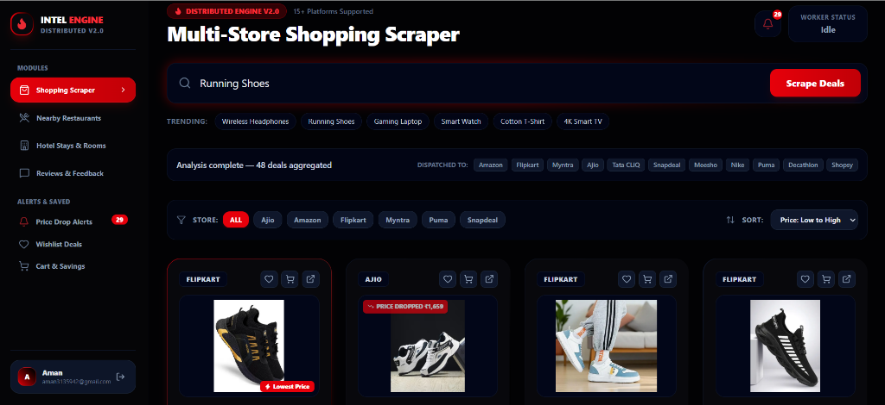
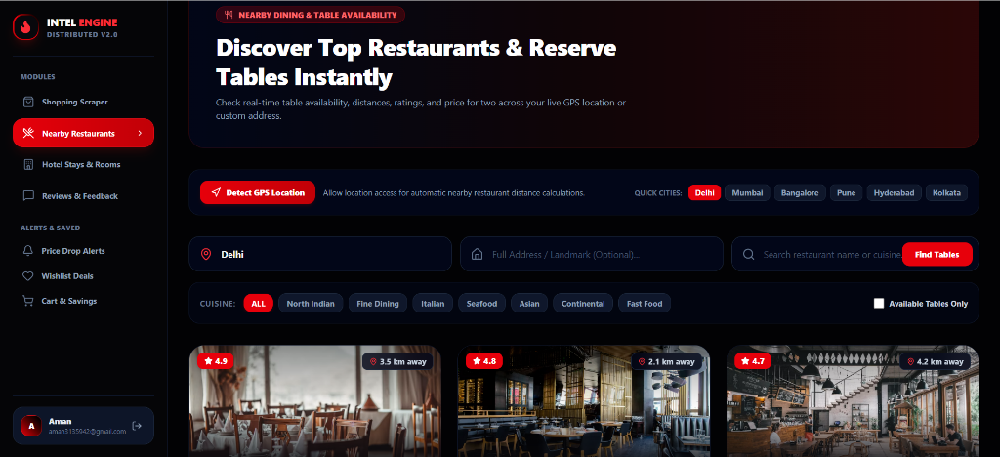
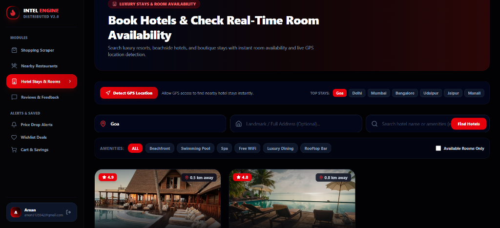
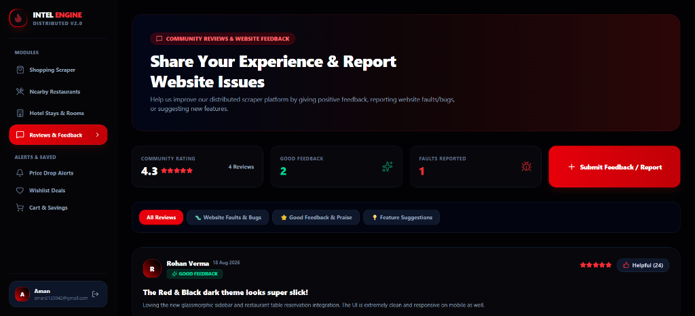

# Intel Engine - Distributed V2.0 🚀
### High-Performance Distributed E-Commerce Scraper & Services Aggregator

Intel Engine V2.0 is a modern, distributed web scraping and data aggregation platform built with React, Node.js, Express, MongoDB, and Redis. It aggregates deals, prices, hotel stays, restaurant table reservations, community reviews, and price-drop notifications across 15+ supported platforms in real-time.

---

## 📸 Screenshots & UI Showcase

### 1. Multi-Store Shopping Scraper
Search and compare live deals across Amazon, Flipkart, Myntra, Ajio, Tata CLIQ, Snapdeal, Meesho, Puma, Nike, and more with instant sorting and lowest price detection.



---

### 2. Nearby Restaurants & Instant Table Reservations
Discover nearby dining, fine dining, and fast food spots with live GPS location detection, distance calculation, ratings, and instant table booking.



---

### 3. Hotel Stays & Real-Time Room Availability
Browse luxury resorts, beachside hotels, and boutique stays. Filter by amenities (Beachfront, Swimming Pool, Spa, Free WiFi, Rooftop Bar) and check instant room availability.



---

### 4. Community Reviews & Website Feedback
Share user experience, report bugs/faults, submit feature suggestions, and upvote helpful community feedback.



---

## 🔥 Key Features

- **Multi-Store Aggregation**: Distributed scraping workers aggregate e-commerce products in parallel.
- **GPS Location Detection**: Auto-detect user coordinates for precise hotel and restaurant distance metrics.
- **Price Drop Alerts**: Track saved items and receive automated notifications when prices fall.
- **Cart & Wishlist Drawers**: Seamless slide-out drawers for managing saved deals and cart items.
- **JWT User Authentication**: Secure login and signup with personalized saved state.
- **Modern Dark UI**: Slick red & black glassmorphic theme designed for speed and responsiveness.

---

## 🛠️ Tech Stack

- **Frontend**: React, Vite, TailwindCSS / Custom Glassmorphic Styling, Lucide Icons
- **Backend API**: Node.js, Express.js, JWT Authentication
- **Worker Engine**: Distributed Worker Nodes, Playwright / Puppeteer Scrapers
- **Database & Cache**: MongoDB (Mongoose Schemas), Redis (Task Queue & Cache)

---

## ⚡ Getting Started

### 1. Clone the Repository
```bash
git clone https://github.com/am-an04/Distributed-e-Commerce-scrapper.git
cd Distributed-e-Commerce-scrapper
```

### 2. Install Dependencies
```bash
npm install
cd frontend && npm install
```

### 3. Environment Setup
Create a `.env` file in the root directory:
```env
PORT=5000
MONGODB_URI=mongodb://localhost:27017/distributed_scraper
REDIS_URL=redis://localhost:6379
JWT_SECRET=your_jwt_secret_key
```

### 4. Run Development Servers
```bash
# Start backend API & worker nodes
npm run dev

# Start React frontend
cd frontend
npm run dev
```

---

## 📄 License
MIT License. Created by Aman.
